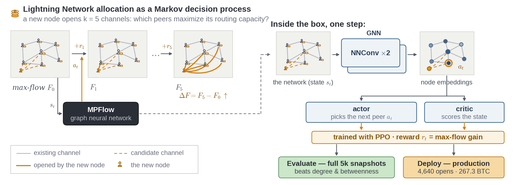

  

<h1 align="center">Harrison Rush</h1>

  <strong>Machine learning engineer - M.S. Computer Science, Georgia Tech</strong> 
  Graph RL, GNNs, forecasting, and evaluation systems for decisions under uncertainty.

  
  
  
  
  

## Research

**[MPFlow: Learning Budgeted Max-Flow Optimization on the Lightning Network with
Deep Graph Reinforcement Learning](https://arxiv.org/abs/2607.08703)**  
First-author arXiv preprint (2026). We used graph reinforcement learning to
select which channels to open under a fixed liquidity budget. MPFlow
outperformed heuristic baselines on unseen network snapshots and was deployed
for 4,640 channel-open decisions across 30 managed nodes.

  

## Selected Work

| Project | What it shows | Status |
| --- | --- | --- |
| [RoboWeather](https://github.com/hrush98/roboweather) | Same-day temperature forecasting and evaluation. Re-scored 18 saved models on 4,364 station-days after discovering outcome leakage in the original evaluation. | Public research · funded trading paused |
| [TinyChat](https://github.com/hrush98/tinychat) | Rust terminal client for local and self-hosted language models with streaming, rules-based routing, and latency traces. | MIT · v0.1 |
| [Footpump](https://github.com/hrush98/footpump) | Multi-source crypto market data, explainable ranking, and persistent watchlists served through FastAPI. | Public |
| [SleeperService](https://github.com/hrush98/sleeperservice) | Prediction-market research case study covering sports feed ingestion, historical replay, and execution safeguards. | Deprecated · public case study |

## Architecture Snapshots

| TinyChat | Footpump |
| --- | --- |
|  |  |

| RoboWeather | SleeperService |
| --- | --- |
|  |  |

  

