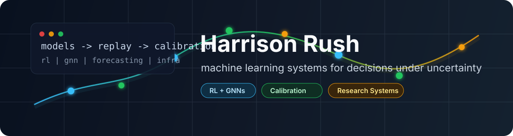
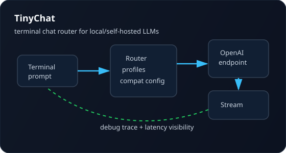
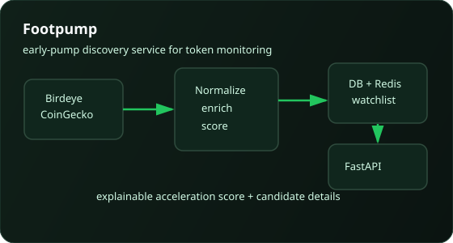
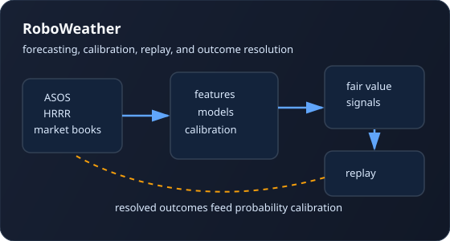
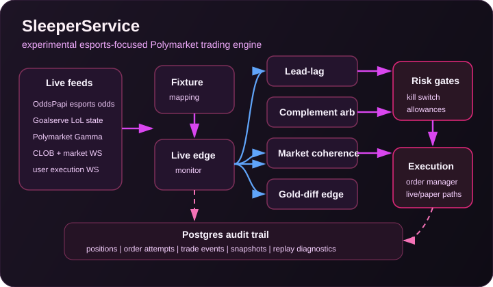

<p align="center">
  
</p>

<h1 align="center">Harrison Rush</h1>

<p align="center">
  <strong>Machine learning engineer building RL, graph neural network, forecasting, and evaluation systems.</strong>
</p>

<p align="center">
  <a href="mailto:hrush9212@gmail.com"></a>
  <a href="https://github.com/hrush98"></a>
  
  
</p>

I like projects where the model is only one part of the system: data quality,
simulation, replay, calibration, deployment, and postmortems all matter.

## Now

- Building ML systems for constrained decision-making with reinforcement
  learning, graph neural networks, and production-style evaluation.
- Turning messy live data into replayable research loops, calibrated decisions,
  and audit trails.
- Keeping public work focused on clean artifacts while proprietary trading and
  execution systems stay high-level.

## Research

**[MPFlow: Learning Budgeted Max-Flow Optimization on the Lightning Network with
Deep Graph Reinforcement Learning](https://arxiv.org/abs/2607.08703)**  
arXiv, 2026. Graph RL for liquidity placement in the Bitcoin Lightning Network,
evaluated on real network snapshots and deployed for production channel-open
decisions.

## Selected Work

| Project | What it shows | Status |
| --- | --- | --- |
| [`tinychat`](https://github.com/hrush98/tinychat) | Rust terminal chat router for OpenAI-compatible local/self-hosted language model endpoints, streaming output, profile routing, and debugging visibility. | Public |
| [`footpump`](https://github.com/hrush98/footpump) | Early-pump discovery service for multi-chain token monitoring, enrichment, scoring, watchlists, and Hermes-facing APIs. | Public |
| RoboWeather | Weather forecasting and market-research system with live observations, forecast guidance, calibration, replay ledgers, and outcome resolution. Public description is intentionally high-level. | Proprietary-sensitive |
| SleeperService | Esports-focused Polymarket analysis platform. Good source material for a future sanitized LoL/esports analytics bot artifact, but not a repo to publish as-is. | Private |

## Architecture Snapshots

| TinyChat | Footpump |
| --- | --- |
| <a href="https://github.com/hrush98/tinychat"></a> | <a href="https://github.com/hrush98/footpump"></a> |

| RoboWeather | SleeperService |
| --- | --- |
|  |  |

## Working Style

```text
raw data -> schemas -> features -> model -> replay -> calibration -> decision trace
```

- Prefer reproducible research loops over one-off notebooks.
- Measure live/replay gaps instead of assuming offline wins will survive contact
  with production.
- Treat failed runs as system diagnostics, not just bad experiments.

## Public Artifact Roadmap

The next clean portfolio piece should be a sanitized `lol-esports-bot` repo:

- schedule and result ingestion
- team/player feature builders
- chronological backtests
- calibration reports
- CLI or Discord bot preview
- sample data and tests only

No credentials, paid datasets, real-money execution, or private strategy code.

## Stack

`Python` `PyTorch` `FastAPI` `SQLAlchemy` `Postgres` `SQLite` `DuckDB` `Rust`
`Docker` `AWS` `Airflow` `MLflow-style tracking`

<p align="center">
  
</p>
